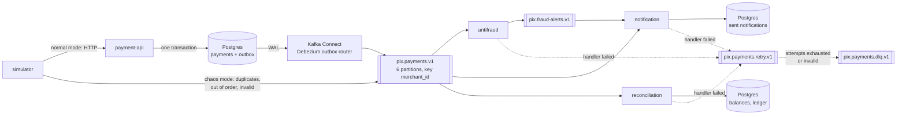

# payments-kafka

A study project: an event pipeline for simulated Pix payments on Apache Kafka,
built to be broken on purpose.

A simulator generates the lifecycle of Pix payments (created, confirmed,
expired, refunded) for many restaurants (merchants). The events reach Kafka
either through a payment API with a transactional outbox and Debezium, or
straight from the simulator with injected faults. Three independent services
consume them: **antifraud** raises alerts, **notification** tells the merchant
(never twice), **reconciliation** keeps balances in Postgres (exactly once in
effect). Four experiments then break the pipeline and show, with numbers, that
it holds.

Everything runs locally with Docker Compose. Pix is simulated: there is no
real bank, PSP or Pix API.

## What you can learn here

| Topic | Where it shows | Experiment or walkthrough |
| --- | --- | --- |
| Partitioning by key, per-merchant ordering | `pix.payments.v1` keyed by `merchant_id` | [walkthrough: partitioning](experiments/walkthrough-partitioning.md) |
| Consumer groups, offsets, lag, rebalancing | three groups on the same topics, scalable consumers | [walkthrough: consumer groups](experiments/walkthrough-consumer-groups.md) · [kill-consumer](experiments/02-kill-consumer.md) |
| At-least-once delivery, idempotent consumers | duplicates injected by the simulator and by Connect | [duplicates](experiments/01-duplicates.md) |
| Retry with backoff, dead letter queue | `pix.payments.retry.v1`, `pix.payments.dlq.v1` | [walkthrough: retry and DLQ](experiments/walkthrough-retry-dlq.md) |
| The outbox pattern (no event lost between DB and Kafka) | payment API + Debezium | [kafka-outage](experiments/03-kafka-outage.md) |
| Reprocessing history by resetting offsets | reconciliation rebuild | [replay](experiments/04-replay.md) |

## Architecture



Two producers (Debezium on the outbox path, the simulator in chaos mode),
four topics, three consumer groups. No consumer knows about the others; the
JSON Schema event contract in [`contracts/`](contracts/) is the only coupling.
Topic names, the event contract, the retry/DLQ protocol, ports and
environment variables are defined once in
[docs/architecture.md](docs/architecture.md).

## Prerequisites

- **Docker** with Compose v2 (Docker Desktop on Windows or macOS, Docker
  Engine on Linux), with about 6 GB of memory available to Docker.
- Free host ports 8080 to 8083, 9092 and 5432.
- That is all to run the pipeline and the experiments. To develop and run the
  tests you also need JDK 21 and Node.js 22 (see each component's README).

Commands below work in PowerShell, cmd and bash. In Windows PowerShell 5.1,
type `curl.exe` instead of `curl`.

## Quick start

From the repository root:

```sh
# 1. Build and start everything (first build: a few minutes)
docker compose --profile apps up -d --build --wait

# 2. Check: every service running or healthy, kafka-init and connector-init "Exited (0)"
docker compose --profile apps ps -a
curl http://localhost:8083/connectors/payments-outbox/status
```

The connector and its task must be `RUNNING`. The default simulator now
publishes about 50 events per second in chaos mode. Open **Kafka UI** at
http://localhost:8080: **Topics → pix.payments.v1 → Messages** shows the
events, **Consumers** shows the three groups and their lag.

```sh
# 3. Watch the consumers
docker compose logs -f reconciliation      # "payment event applied", "duplicate event ignored", retries
docker compose logs -f notification        # {"type":"notification",...} lines
docker compose logs -f antifraud           # "fraud alert published"

# 4. Read the simulator's counters and reconciliation's view
curl http://localhost:8082/stats
docker compose exec -T reconciliation node services/reconciliation/dist/cli.js check
docker compose exec -T reconciliation node services/reconciliation/dist/cli.js balances
```

### Follow one payment through the outbox

In normal mode a payment travels: API → `payments` + `outbox` rows (one
transaction) → Debezium → `pix.payments.v1` (key `merchant_id`) → consumers.
Trace one from the tooling container, which has `curl`, `jq`, `psql` and
`kcat` whatever your host shell is:

```sh
docker compose --profile experiments run --rm experiments shell
```

Then, in that shell:

```sh
# Create and confirm a payment through the API
ID=$(curl -s -X POST http://payment-api:8081/payments -H 'Content-Type: application/json'   -d '{"merchant_id": "merchant-trace", "amount_cents": 4590}' | jq -r .payment_id)
curl -s -X POST "http://payment-api:8081/payments/$ID/confirm" | jq .

# 1. API database: the payment, and one outbox row per state change (the row id is the event_id)
psql -d payments -c "SELECT id, status, sequence FROM payments WHERE id = '$ID'"
psql -d payments -c "SELECT id, event_type, merchant_id FROM outbox WHERE aggregate_id = '$ID' ORDER BY created_at"

# 2. The topic: two records with key merchant-trace, value = the outbox payload
#    (Debezium publishes within a second or so; run it again if nothing shows yet)
sleep 2
kcat -C -b kafka:29092 -t pix.payments.v1 -o beginning -e -q -f '%p %o %k %s
' 2>/dev/null | grep "$ID"

# 3. Reconciliation: status CONFIRMED, merchant credited
psql -d reconciliation -c "SELECT payment_id, status, last_sequence FROM payments WHERE payment_id = '$ID'"
psql -d reconciliation -c "SELECT * FROM merchant_balances WHERE merchant_id = 'merchant-trace'"

# 4. Notification: one line for the confirmation
docker logs payments-kafka-notification-1 2>&1 | grep "$ID"
exit
```

The same tables and topic are visible in Kafka UI (search the topic's
messages for `merchant-trace`) and from the host with
`docker compose exec postgres psql -U pix -d payments`.

## Run the experiments

```sh
docker compose --profile experiments run --rm experiments help
docker compose --profile experiments run --rm experiments all
```

`all` runs the four experiments in sequence (about 6 minutes) and prints a
summary. Each one resets the topics and the consumers' state first and stops
the default simulator; [experiments/README.md](experiments/README.md) explains
what they do, how they measure, and how to make each one fail on purpose
(`-e SABOTAGE=1`).

| Experiment | Breaks | Shows |
| --- | --- | --- |
| [duplicates](experiments/01-duplicates.md) | 20 % of events published twice | balances equal those of the same run without duplicates; no notification sent twice |
| [kill-consumer](experiments/02-kill-consumer.md) | `docker kill` of a reconciliation instance mid-run | every distinct event applied exactly once; `check` passes |
| [kafka-outage](experiments/03-kafka-outage.md) | `docker stop kafka` for 20 s while the API takes payments | the API keeps answering; every outbox row reaches the topic and reconciliation |
| [replay](experiments/04-replay.md) | reconciliation state deleted, offsets rewound to 0 | byte-identical balances after the rebuild |

## Components

| Component | Language | README |
| --- | --- | --- |
| Local environment (Kafka, Connect, Postgres, Kafka UI) | Docker Compose | [infra/README.md](infra/README.md) |
| Event contracts | JSON Schema | [contracts/](contracts/) |
| Payment API with transactional outbox | Java 21, Spring Boot | [services/payment-api/README.md](services/payment-api/README.md) |
| Simulator (normal and chaos mode) | Java 21, Spring Boot, Spring Kafka | [services/simulator/README.md](services/simulator/README.md) |
| Consumer runtime (commits, validation, retry, DLQ) | TypeScript, `@confluentinc/kafka-javascript` | [packages/consumer-runtime/README.md](packages/consumer-runtime/README.md) |
| Antifraud | TypeScript | [services/antifraud/README.md](services/antifraud/README.md) |
| Notification | TypeScript | [services/notification/README.md](services/notification/README.md) |
| Reconciliation | TypeScript | [services/reconciliation/README.md](services/reconciliation/README.md) |
| Experiments and walkthroughs | bash in a tooling container | [experiments/README.md](experiments/README.md) |

| URL | What |
| --- | --- |
| http://localhost:8080 | Kafka UI |
| http://localhost:8081 | payment API |
| http://localhost:8082/stats | simulator counters |
| http://localhost:8083/connectors | Kafka Connect REST |
| `localhost:9092` | Kafka (from the host) |
| `localhost:5432` | Postgres, user `pix`, password `pix` |

## Tests

Each component has its own tests, which use Testcontainers (random ports) and
never the Compose stack; Docker must be running.

```sh
npm install && npm test                          # TypeScript: runtime and the three consumers
cd services/payment-api && ./mvnw verify          # Java (mvnw.cmd on Windows)
cd services/simulator && ./mvnw verify
```

The experiments are the end-to-end tests of the whole stack.

## Stop and reset

```sh
docker compose --profile apps stop        # stop, keep data
docker compose --profile apps down -v     # remove containers and volumes: topics, databases, offsets
```

## Troubleshooting

- **A port is already in use**: another program uses 8080-8083, 9092 or 5432.
  Stop it, or change the host side of the port in `docker-compose.yml`.
- **`container name "/kafka" is already in use`**: a container with that name
  exists from another Compose project: `docker rm -f kafka` (or `postgres`,
  ...).
- **`up --wait` fails or a Java service stays `starting`**: the first start
  of Spring Boot can be slow on a small machine. Look at
  `docker compose logs payment-api`, then run the same `up` command again.
- **Postgres exits complaining about data in `/var/lib/postgresql/data`**: a
  volume from an older Postgres major version; reset with
  `docker compose --profile apps down -v`.
- **Connector not `RUNNING`**: `curl http://localhost:8083/connectors/payments-outbox/status`
  shows the trace; see [infra/README.md](infra/README.md#the-outbox-connector).
- **Consumers far behind / nothing in Kafka UI**: the default simulator is
  stopped after an experiment; start it with
  `docker compose --profile apps start simulator`.
- **An experiment stopped half-way** (Ctrl+C): see
  [experiments/README.md](experiments/README.md#troubleshooting).
- **Git Bash on Windows rewrites container paths** such as
  `/opt/kafka/bin/...` in `docker exec`: prefix the command with
  `MSYS_NO_PATHCONV=1`, or use PowerShell.

## How this project was built

Spec-first with [OpenSpec](https://github.com/Fission-AI/OpenSpec): each
component was an OpenSpec change. The final specifications are in
[openspec/specs/](openspec/specs/) and the completed changes in
[openspec/changes/archive/](openspec/changes/archive/).
